# Informe Técnico: Stack de Observabilidad con Código Abierto

**Práctica Final Integradora** · Taller Observabilidad Infraestructura con Stack Open Source · Universidad Andrés Bello

**Autores:** Sebastián Hidalgo, Vanessa Lagos, Claudio Ojeda, Héctor Peña

**Repositorio:** https://github.com/sebastianihg05/observabilidad-stack-infra

Las capturas de pantalla se indican con marcadores de la forma `[CAPTURA: nombre]` y se entregan por separado.

## Resumen

Se desplegó con Docker Compose un stack de observabilidad que cubre los tres pilares:

| Pilar | Componentes |
|---|---|
| Métricas | Prometheus, Node Exporter, agente SNMP simulado y SNMP Exporter |
| Logs | Loki y Promtail |
| Trazas | OpenTelemetry Collector, Jaeger y la aplicación de prueba HotROD |

Además, se complementó el sistema con visualizaciones y alertas utilizando Grafana y un receptor de webhook simulado.

### Entorno utilizado
- Windows 11, Docker Desktop (motor 29.8.1), Git y Visual Studio Code.
- Todos los contenedores comparten la red `monitoreo-net` (subred `172.21.0.0/24`) y su nombre lleva el prefijo `obs_`.

### Puertos expuestos

| Servicio | Puerto | Uso |
|---|---|---|
| Prometheus | 9090 | Interfaz y consultas PromQL |
| Node Exporter | 9100 | Métricas del sistema |
| SNMP Exporter | 9116 | Traductor SNMP a métricas |
| Agente SNMP simulado | 161/udp | Router simulado |
| Loki | 3100 | Almacén de logs |
| Grafana | 3000 | Dashboards y alertas |
| Receptor de webhook | 8081 | Aviso simulado de alertas |
| HotROD | 8080 | Aplicación de microservicios |
| Jaeger | 16686 | Interfaz de trazas |
| OTEL Collector | 4318 | Recepción OTLP por HTTP |

### Estructura del repositorio

```
observabilidad-stack-infra/
├── docker-compose.yml
├── prometheus/prometheus.yml
├── snmp/ (Dockerfile y snmpd.conf)
├── promtail/promtail-config.yml
├── cloud-logs/eventos-nube.json
├── grafana/
│   ├── dashboards/dashboard-operativo.json
│   └── provisioning/ (datasources, dashboards y alerting)
├── otel/otel-collector-config.yaml
├── scripts/generar_logs.sh
├── INFORME.md
└── README.md
```

---

## 1. Paso a paso documentado

Todos los comandos se ejecutan dentro de la carpeta del repositorio, en la rama `develop`.

### 1.1 Preparación

Se verificó que Docker Desktop estuviera activo:

```bash
docker version
```

El comando debe mostrar las secciones **Client** y **Server**. Si solo aparece Client, el motor de Docker no está encendido.

### 1.2 Infraestructura base y métricas

Se levantaron Prometheus, Node Exporter, el agente SNMP simulado y el SNMP Exporter:

```bash
docker compose up -d --build prometheus node-exporter snmp_exporter router_sim
docker compose ps
```

La primera ejecución tarda varios minutos porque el agente SNMP (`net-snmp`) se compila desde su código fuente en el `Dockerfile`.

**Validación.** En http://localhost:9090/targets los tres trabajos deben figurar en estado **UP**: `prometheus`, `node-exporter` y `snmp_router`.

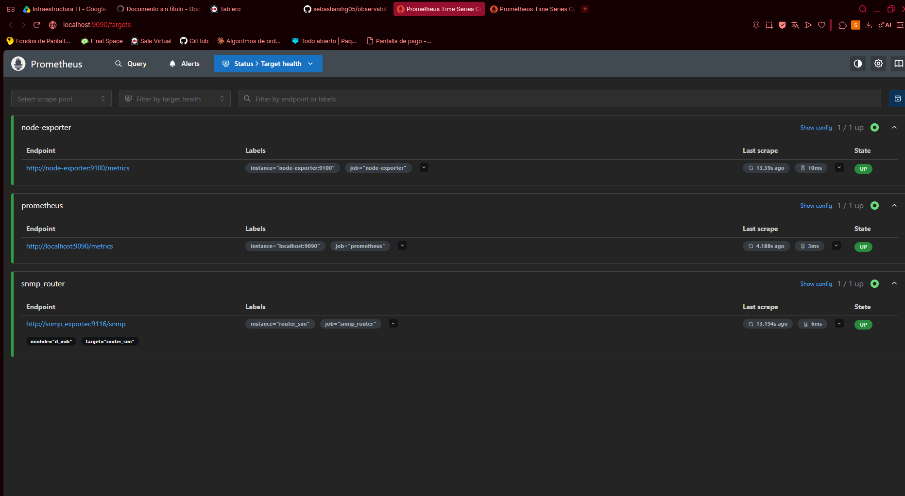


**Consultas PromQL construidas** (en http://localhost:9090/graph):

Uso de CPU en porcentaje:

```
100 - (avg(rate(node_cpu_seconds_total{mode="idle"}[5m])) * 100)
```

Ancho de banda de entrada de la interfaz `eth0` en Mbps:

```
rate(ifHCInOctets{instance="router_sim", ifDescr="eth0"}[1m]) * 8 / 1000000
```

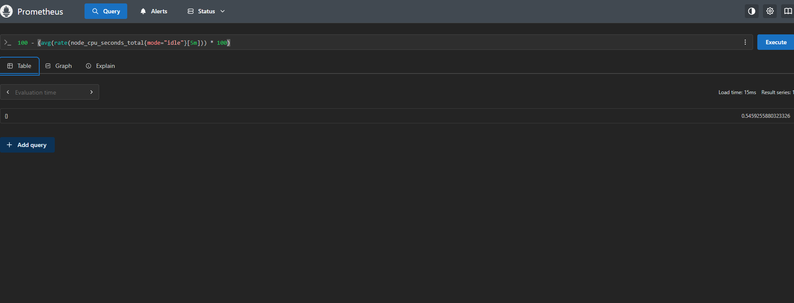
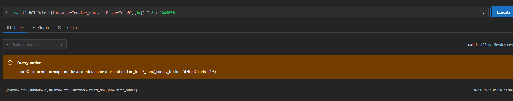

### 1.3 Centralización de logs

Se creó el archivo `cloud-logs/eventos-nube.json` con un evento JSON por línea y se configuró Promtail con un pipeline de extracción JSON. Luego se levantaron los servicios:

```bash
docker compose up -d loki promtail
```

Para generar eventos continuos se utiliza el script `scripts/generar_logs.sh`, que añade un evento cada 2 segundos con severidad `INFO`, `WARNING` o `ERROR`:

```bash
bash scripts/generar_logs.sh
```

**Validación.** En Grafana, sección Explore con la fuente Loki, la consulta siguiente devuelve los eventos de error y la etiqueta `level` aparece con sus tres valores:

```
{job="nube_simulada_seba", level="ERROR"}
```

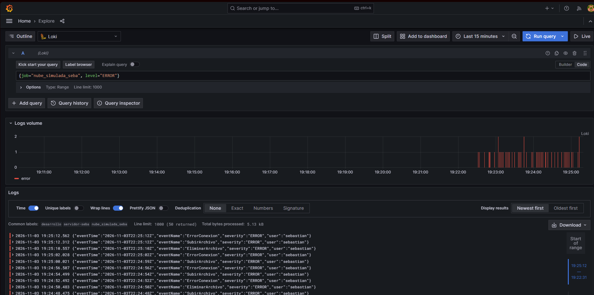

### 1.4 Visualización y alertas

Se levantaron Grafana y el receptor de webhook:

```bash
docker compose up -d grafana webhook
```

Grafana queda disponible en http://localhost:3000. Las fuentes de datos Prometheus y Loki se cargan automáticamente desde `grafana/provisioning/datasources/datasources.yml`.

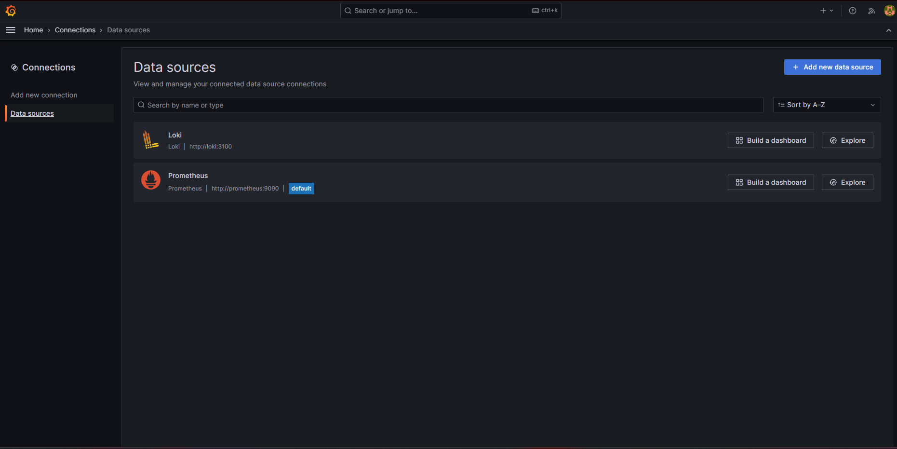

**Dashboard Operativo.** Se construyó un dashboard único con tres paneles obligatorios y uno adicional de CPU:

| Panel | Tipo | Fuente | Consulta |
|---|---|---|---|
| Tráfico de red eth0 (Mbps) | Serie de tiempo | Prometheus | La consulta de ancho de banda de la sección 1.2 |
| Uso de disco (%) | Medidor | Prometheus | `100 - (node_filesystem_avail_bytes{mountpoint="/etc/hosts"} / node_filesystem_size_bytes{mountpoint="/etc/hosts"} * 100)` |
| Eventos de la nube en vivo | Logs | Loki | `{job="nube_simulada_seba"}` |

El dashboard se exportó a `grafana/dashboards/dashboard-operativo.json` y se carga automáticamente al iniciar Grafana. Tiene un refresco de 5 segundos y un rango de 15 minutos.

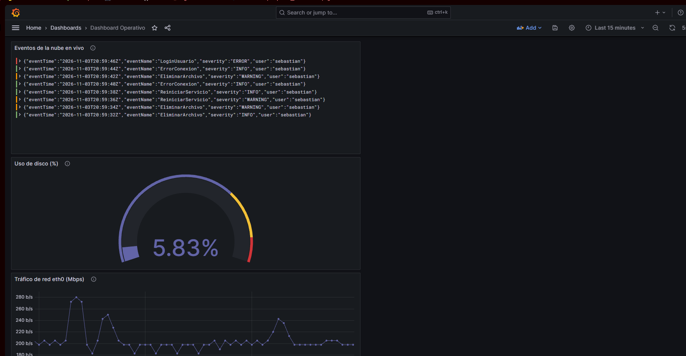

**Alerta de CPU con webhook.** Se configuraron tres elementos:

1. **Contact point** `webhook-seba`, de tipo Webhook, con la URL `http://webhook:8080`. Se verificó con el botón de prueba de Grafana.
2. **Regla de alerta** `CPU sobre 75%` en la carpeta `alertas-infra` y el grupo `cpu-servidor` (evaluación cada 1 minuto), con la etiqueta `destino = webhook`.
3. **Política de notificación** que envía al contact point `webhook-seba` toda alerta con la etiqueta `destino = webhook`.

Para comprobar el funcionamiento se bajó temporalmente el umbral a `0.1`; la alerta pasó a **Firing** y el receptor registró el aviso:

```bash
docker logs obs_webhook --tail 40
```

Luego el umbral se restableció a `75`. La configuración de la alerta quedó exportada en `grafana/provisioning/alerting/` (`reglas.yml`, `contact-points.yml` y `politicas.yml`).

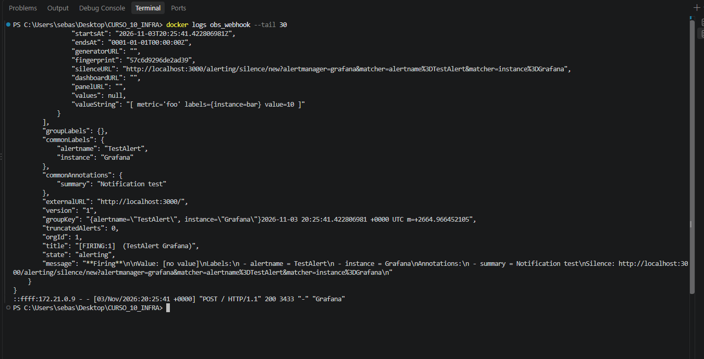
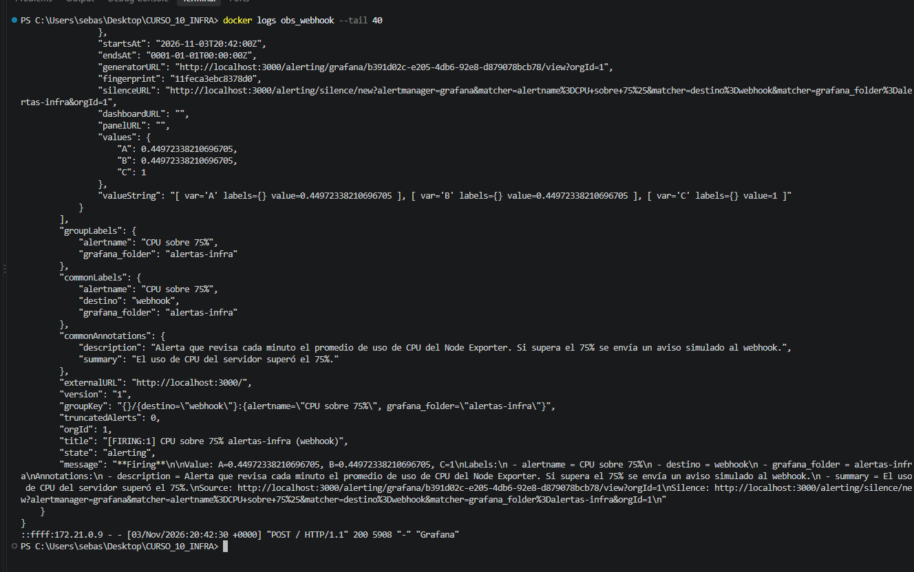
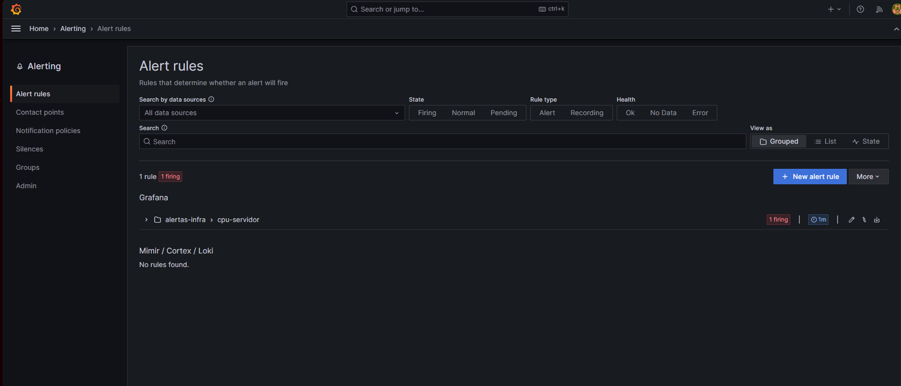
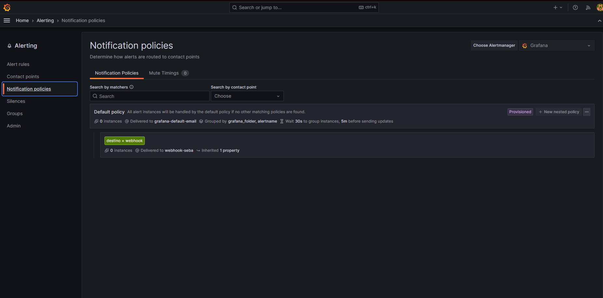

### 1.5 Trazabilidad distribuida y APM

Se configuró el OpenTelemetry Collector (`otel/otel-collector-config.yaml`) y se levantaron Jaeger, el Collector y HotROD:

```bash
docker compose up -d jaeger otel-collector hotrod
```

Para generar trazas se utilizó la interfaz de HotROD en http://localhost:8080, haciendo varias solicitudes desde los botones de cliente. En la interfaz de Jaeger (http://localhost:16686) se seleccionó el servicio `frontend` y se ejecutó **Find Traces**.

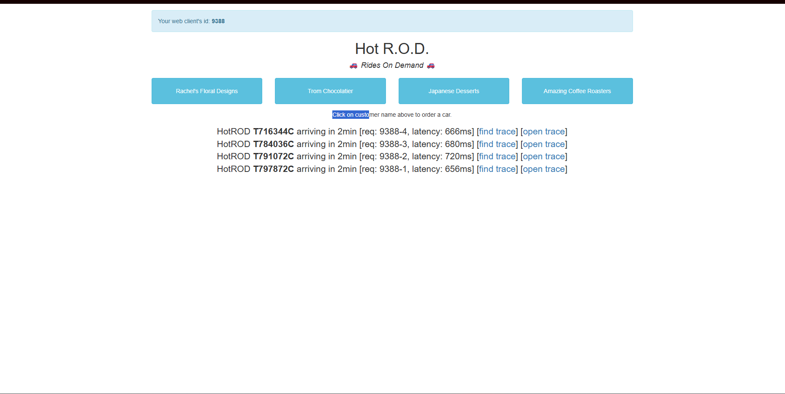
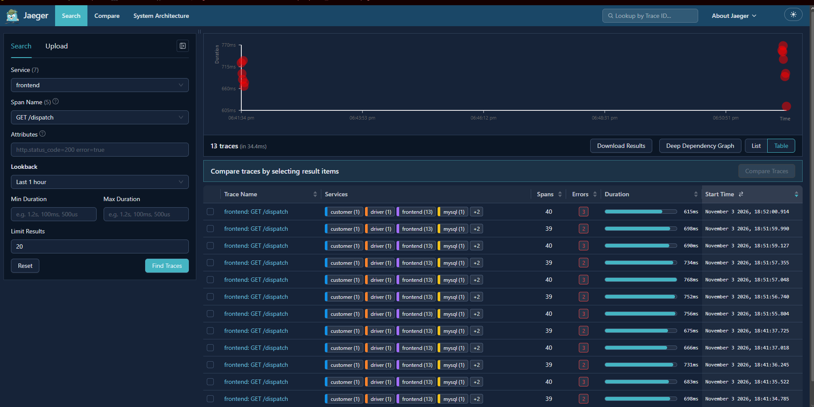

**Análisis de una transacción.** En una traza de la operación `GET /dispatch` se identificaron los tramos más largos:

| Duración | Servicio | Operación |
|---|---|---|
| 668 ms | frontend | GET /dispatch (total) |
| 254 ms | customer | GET /customer |
| 253 ms | mysql | SQL SELECT |
| 219 ms | driver | FindNearest |

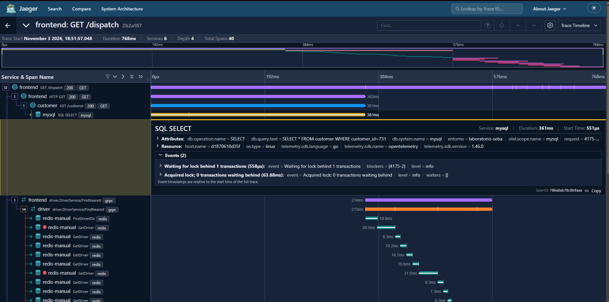

### 1.6 Prueba de reproducibilidad

Para comprobar que el stack se levanta desde cero:

```bash
docker compose down
docker compose up -d --build
```

Tras recrear Grafana, el dashboard, la regla de alerta, el contact point y la política de notificación se cargaron sin intervención manual, porque están definidos en archivos del repositorio.

---

## 2. Justificación técnica

### 2.1 Métricas y consultas PromQL

- **CPU con `mode="idle"`.** Node Exporter entrega el tiempo acumulado que cada núcleo pasa en cada modo. El tiempo ocioso es el más estable de medir, y el uso real se obtiene restándolo de 100.
- **`rate(...[5m])`.** Las métricas de CPU y de tráfico son contadores que solo crecen. `rate()` los convierte en una tasa por segundo y descarta los reinicios del contador. La ventana de 5 minutos suaviza los picos en la CPU.
- **`avg(...)` en la CPU.** Promedia los núcleos para obtener un solo valor de uso del servidor, adecuado para una alerta.
- **`ifHCInOctets` en la red.** Es el contador de 64 bits de bytes recibidos. Se prefirió al de 32 bits (`ifInOctets`) porque este último se desborda rápidamente en enlaces rápidos.
- **`* 8 / 1000000`.** Convierte bytes por segundo en megabits por segundo (Mbps).
- **Ventana de 1 minuto en la red.** Con un intervalo de recolección de 15 segundos permite una curva más reactiva al tráfico.
- **Filtro `ifDescr="eth0"`.** El agente reporta dos interfaces, `eth0` y `lo` (loopback). Se fijó `eth0` para medir el tráfico real y excluir el interno.
- **Módulo `if_mib` y recolección con `relabel_configs`.** El SNMP Exporter actúa como intermediario. Las reglas de reetiquetado pasan el objetivo (`router_sim`) como parámetro y mantienen su nombre en la etiqueta `instance`, para que los paneles muestren el equipo real y no la dirección del exportador.
- **Uso de disco con `mountpoint="/etc/hosts"`.** En Docker Desktop, Node Exporter se ejecuta dentro de una máquina virtual y no expone el punto de montaje `/`. El punto `/etc/hosts` pertenece al sistema de archivos `ext4` de esa máquina y entrega el porcentaje de uso del disco del entorno.

### 2.2 Logs y etiquetas

- **Pipeline JSON en Promtail.** Se utilizan dos etapas: `json`, que extrae los campos `severity` (como `level`) y `eventName` (como `action`), y `labels`, que promueve solo `level` a etiqueta.
- **Solo `level` como etiqueta.** Las etiquetas de Loki forman el índice. Se indexó únicamente la severidad, que tiene pocos valores (INFO, WARNING y ERROR) y permite filtrar con rapidez. La acción (`eventName`) queda dentro del contenido del log para no aumentar la cardinalidad del índice.
- **Etiquetas fijas `job`, `env` y `host`.** Identifican el origen de los eventos (`nube_simulada_seba`, `desarrollo` y `servidor-seba`) y permiten separarlos de los logs del sistema (`job=varlogs`).
- **Consulta LogQL `{job="nube_simulada_seba", level="ERROR"}`.** Selecciona primero el flujo por etiquetas, que es el método eficiente en Loki, y no recorre el contenido de todos los logs.

### 2.3 Dashboard y alertas

- **Tres paneles obligatorios.** Red (serie de tiempo), disco (medidor con umbrales de 70 % y 90 %) y logs (panel de logs con refresco de 5 segundos), que cubren las tres áreas pedidas en el enunciado.
- **Colores.** Se utilizó un morado como color principal, con amarillo y rojo en los umbrales altos del medidor para que el riesgo se distinga con claridad.
- **Umbral de CPU de 75 %.** Deja un margen antes de la saturación total y evita avisos por picos breves normales.
- **Enrutamiento por etiqueta.** La regla lleva `destino = webhook` y una política de notificación envía esa etiqueta al contact point. Esta es la forma de enrutamiento de Grafana 10.2 y permite agregar más destinos sin modificar la regla.
- **Webhook simulado.** Un contenedor receptor que registra cada solicitud en su salida. Demuestra el aviso de la alerta sin depender de un servicio externo ni de credenciales.
- **Aprovisionamiento por archivos.** Las fuentes de datos, el dashboard y la alerta se definen en archivos, de modo que el entorno se reconstruye sin configuración manual.

### 2.4 Trazas

- **OTEL Collector como intermediario.** La aplicación envía las trazas por OTLP/HTTP al Collector, y este las reenvía a Jaeger. Así la aplicación no depende del almacén de trazas y se pueden agregar procesadores sin modificarla.
- **Procesador `batch`.** Agrupa los datos antes de enviarlos y reduce el número de conexiones.
- **Atributo propio `entorno = laboratorio-seba`.** El procesador `attributes/entorno` lo agrega a todas las trazas. Permite filtrarlas en Jaeger y distinguir su origen.
- **HotROD como aplicación de prueba.** Está formada por varios microservicios (`frontend`, `customer`, `driver`, `route`, `mysql`), lo que permite observar una transacción distribuida.

---

## 3. Evidencia de funcionamiento

### 3.1 Métricas

- Los tres trabajos de Prometheus (`prometheus`, `node-exporter` y `snmp_router`) están en estado UP.
  `[CAPTURA: 01-targets-prometheus]`
- La consulta de CPU devuelve el porcentaje de uso del servidor, y la de red devuelve valores en Mbps para `eth0`. El tráfico es bajo (del orden de 0,0002 Mbps) porque es una red de laboratorio sin carga.
  `[CAPTURA: 02-promql-cpu]` · `[CAPTURA: 03-promql-mbps]`

### 3.2 Logs

- La etiqueta `level` aparece con los valores ERROR, INFO y WARNING, y la consulta por `ERROR` devuelve solo esos eventos.
  `[CAPTURA: 05-loki-level-error]`

### 3.3 Dashboard Operativo

- Los tres paneles muestran datos al mismo tiempo: tráfico de red de `eth0`, uso de disco en torno al 5,8 % y eventos de la nube en vivo con marcas de color por severidad.
  `[CAPTURA: 07-dashboard-operativo]`

### 3.4 Alerta y webhook

- La regla `CPU sobre 75%` cambia a estado **Firing** al bajar el umbral de prueba.
  `[CAPTURA: 10-alerta-firing]`
- El receptor registró el aviso con el título `[FIRING:1] CPU sobre 75% alertas-infra (webhook)`, las etiquetas `alertname` y `destino`, el valor medido y las anotaciones `summary` y `description`.
  `[CAPTURA: 09-webhook-recibido]`

### 3.5 Trazas

- Jaeger recibe las trazas de los servicios `frontend`, `customer`, `driver`, `route`, `mysql` y `redis-manual`. Cada traza contiene la etiqueta `entorno = laboratorio-seba`.
  `[CAPTURA: 13-jaeger-lista-trazas]`
- **Cuello de botella.** En una traza de `GET /dispatch` de 668 ms, la consulta `SQL SELECT` al servicio `mysql` ocupa unos 253 ms, aproximadamente el 38 % de la duración total. El servicio `customer` espera esa consulta, por lo que su tiempo (254 ms) es casi igual. La latencia proviene de la base de datos y no del código del `frontend`.
  `[CAPTURA: 14-jaeger-traza-mysql]`

---

## 4. Conclusiones y lecciones aprendidas

### Conclusiones

- Los tres pilares se complementan. Las métricas señalan que algo cambia (CPU, red o disco), los logs entregan el contexto de lo ocurrido y las trazas ubican dónde se pierde el tiempo dentro de una transacción.
- Con herramientas de código abierto y un solo archivo de Docker Compose se obtiene un entorno completo y reproducible, sin licencias ni servicios externos.
- Grafana funciona como punto único de observación: reúne métricas de Prometheus y logs de Loki en un mismo dashboard y permite alertar sobre ellos.
- El análisis de la traza demostró el valor de la trazabilidad: la métrica de CPU o de red no habría revelado que la consulta a `mysql` concentraba casi el 38 % de la latencia.

### Lecciones aprendidas

- **Rutas con caracteres especiales.** Una carpeta con el símbolo `%` en su nombre impidió que Docker Compose leyera el proyecto. Se resolvió renombrándola. Conviene evitar caracteres especiales en las rutas de trabajo.
- **Docker Desktop debe estar activo.** Sin el motor encendido, el cliente de Docker se conecta pero los comandos fallan con un error de conexión.
- **Las consultas deben validarse en el entorno real.** El punto de montaje `/` de las consultas de disco no existe dentro de Docker Desktop, y fue necesario descubrir cuál existía.
- **Compilar `net-snmp` desde su fuente es lento y frágil.** Es la etapa que más tarda al levantar el entorno y depende de una descarga externa.
- **Los nombres entre contenedores deben coincidir.** Un error de escritura en un servicio, o un cambio de nombre, rompe los objetivos de Prometheus y los destinos de Promtail.
- **El enrutamiento de alertas en Grafana 10.2 es por etiquetas.** La regla no elige el contact point directamente, sino que se vincula mediante una política de notificación.
- **Persistencia en Grafana.** Sin un volumen de datos, lo creado en la interfaz se pierde al recrear el contenedor. Por eso el dashboard y la alerta se exportaron a archivos de aprovisionamiento.
- **Cuidado al exportar configuración.** Las exportaciones pueden traer valores ficticios (`[REDACTED]`) o elementos predeterminados que deben limpiarse antes de guardarlos.
- **Ejecutar Git en la carpeta correcta.** Desde una carpeta superior, Git usó otro repositorio y los comandos fallaron. Conviene abrir el editor directamente en la carpeta del proyecto.
